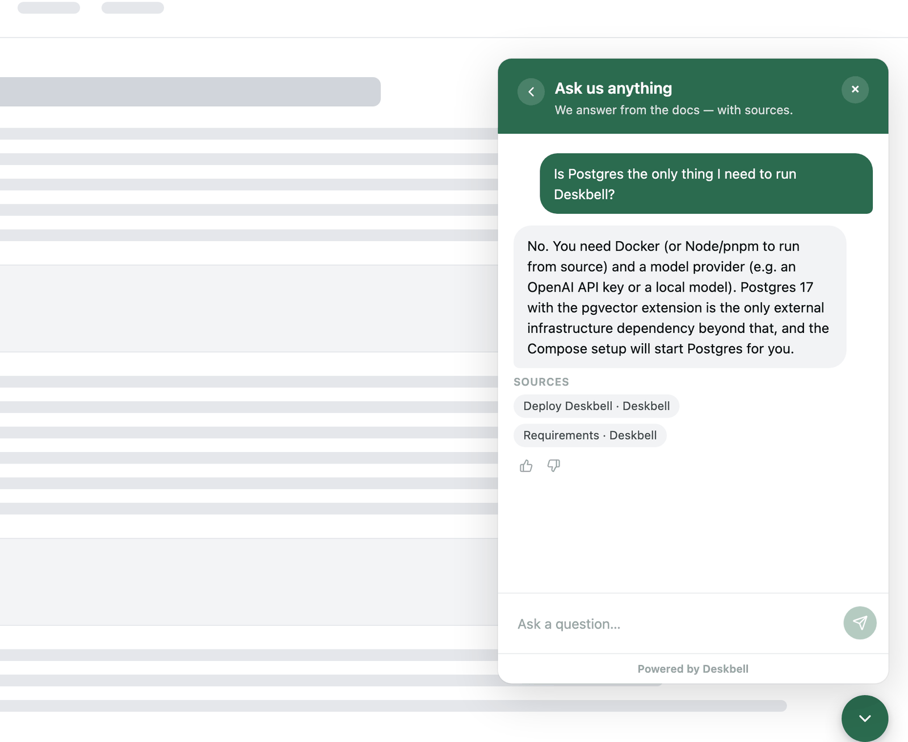
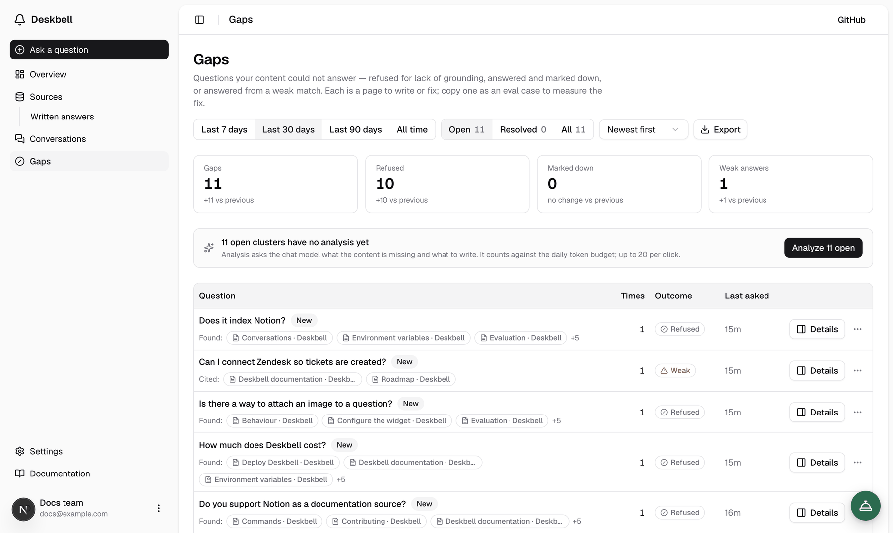
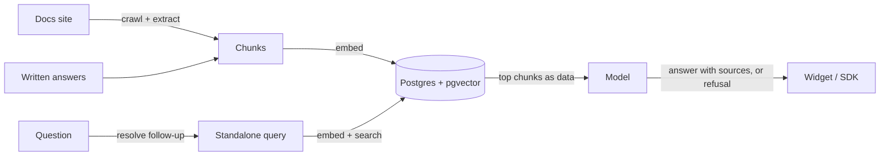

<p align="center">
  
</p>

<h1 align="center">Deskbell</h1>

<p align="center"><strong>The open-source answer engine for your docs.</strong></p>

<p align="center">
  Deskbell answers your users' questions from your documentation, with a citation for every answer and an honest "I don't know" when the docs do not say. Self-hosted, any model, your brand. Actions through MCP are on the roadmap.
</p>

<p align="center">
  <a href="https://deskbell.dev">Website</a> ·
  <a href="https://deskbell.dev/docs">Docs</a> ·
  <a href="#quick-start">Quick start</a> ·
  <a href="./ROADMAP.md">Roadmap</a> ·
  <a href="./CONTRIBUTING.md">Contributing</a>
</p>

<p align="center">
  <a href="./LICENSING.md"></a>
  <a href="https://github.com/deskbellhq/deskbell/actions/workflows/ci.yml"></a>
  <a href="https://deskbell.dev/docs"></a>
  <a href="./CONTRIBUTING.md"></a>
</p>

<p align="center">
  
</p>

> **Where it stands.** The whole path works: crawl a docs site, ask through the
> widget, get a cited answer or a refusal, see what the docs could not answer on
> the Gaps page, measure a change with the eval harness. [ROADMAP.md](./ROADMAP.md)
> has the table of what works and what does not.

## Why Deskbell

- **The answering core is open source, for good.** Retrieval, grounding, citations,
  refusals and the eval harness are AGPL-3.0 and stay that way. The Enterprise
  Edition is the operations plane (multi-organisation, SSO/SCIM, audit log) and its
  boundary is enumerated in [`packages/ee/FEATURES`](./packages/ee/FEATURES).
- **Grounded, or silent.** Every answer cites the pages it came from. When the docs
  do not contain the answer, Deskbell says so instead of guessing, and keeps what it
  retrieved so you can see why.
- **Any model.** OpenAI, Anthropic, Google, or fully local through Ollama, plus anything that
  speaks the OpenAI-compatible protocol (vLLM, LM Studio, llama.cpp). Provider SDKs
  are imported in one module; the rest of the code never sees them.
- **Your servers, your data.** `docker compose up`, with Postgres as the only service
  to run. Support conversations are personal data; here they never leave your
  infrastructure, and visitor IP addresses are never stored.

## Features

**Answers**

- Grounded retrieval, a citation per answer, and a refusal when the docs do not cover
  the question. Follow-ups are rewritten to stand alone before retrieval, so "and how
  do I configure it?" finds the right page.
- Hybrid retrieval (vector + full-text) and reranking are switches, off by default:
  on the tuning corpus they did not beat plain vector search, and the harness is
  there for you to check on yours.

**Knowledge**

- Website crawler: sitemap first, links as the fallback, `robots.txt` respected,
  resumable re-indexing when you change embedding models.
- Written answers: type the answer to a question the docs miss. It is indexed like a
  page and cited by the widget as a written answer.
- Not built yet: help-centre, Confluence, GitHub, Discord and Slack connectors. They
  are next on the [roadmap](./ROADMAP.md).

**Actions**

- Attach MCP servers to a project and the widget can look up a visitor's own data and
  act for them. Every tool is off until you allow it; a tool marked as needing
  confirmation runs only after the visitor confirms a card; results are cited and every
  call is recorded. The server receives a signed visitor identity when you ask for one.

**Widget**

- One script tag. Preact in a shadow root, nothing third-party beyond it, and the
  build fails past 40 KB gzipped. Also available as a web component
  (`@deskbell/widget`), a React wrapper (`@deskbell/widget-react`) and a headless
  typed client (`@deskbell/sdk`).
- Brandable through options, theme tokens, CSS parts and slots. Inline mode, Markdown
  answers, welcome cards, a thread sidebar, and a colour scheme that follows the host
  page. See [widget customization](./docs/widget-customization.md).
- Visitor identity: name your OpenID issuer and the widget verifies your users'
  tokens, so conversations follow a signed-in visitor across browsers and your staff
  get a read-only preview.

**Dashboard**

- Sources, Conversations with votes and reasons, Gaps, Appearance, Install (project
  key, snippet, origin allowlist, daily token budget, install verification), Members
  and roles, Notifications.
- Gaps: unanswered, downvoted and weakly answered questions clustered by meaning, with
  trend against the previous period, resolve and reopen, model-written findings and
  recommendations, and export as CSV or as an eval dataset.

<p align="center">
  
</p>

- Notifications on negative feedback to a Slack incoming webhook or a signed JSON
  webhook, per-channel event toggles, a custom message template.

**Quality**

- An eval harness ships with the product and runs in CI on a fixture set. It reports
  recall@k, precision@k, MRR and nDCG for retrieval, and factuality and groundedness
  separately for answers, so neither can hide the other. Real-corpus and LLM-judged
  runs are opt-in. Gaps export as eval cases, so the questions you measure are the
  ones people asked.

**Operate**

- Postgres 17 with pgvector is the only service. Jobs run on pg-boss. Weaviate is an
  optional vector-store driver for a cluster you already run; the install never
  needs it.
- Dashboard sign-in with email and password, invitation-only membership, roles. Sign
  in with Google is optional and env-gated: a login method, not identity-provider SSO.
- Widget abuse protection: origin allowlist, per-IP and per-project rate limits, daily
  token budgets. Ingested content is data, never instructions.

## How it works

Two loops share nothing but the database, so ingestion runs while people are asking.



The retrieved chunks reach the model as numbered context blocks in a user turn; the
system prompt is byte-identical whatever was retrieved, which is what keeps a hostile
page from becoming instructions. The model ends with a line naming the blocks it
used; only those become citations. If the context does not answer the question, the
model returns a sentinel and the visitor sees a refusal, not prose.
[How it works](./apps/docs/content/docs/how-it-works.mdx) has the whole path.

## Quick start

You need Docker with Compose and an API key for a model provider. Compose starts
Postgres for you; nothing else is required. The defaults name OpenAI; Anthropic,
Google and local models through Ollama work with a different key and model id.

```bash
git clone https://github.com/deskbellhq/deskbell
cd deskbell
cp .env.example .env   # set BETTER_AUTH_SECRET and OPENAI_API_KEY
docker compose up
```

Open [localhost:3000](http://localhost:3000). The overview walks you through the
first run: add a documentation site you control, ask it something the docs answer
and something they do not, then put the widget on your site. One tag:

```html
<script
  async
  src="https://your-deskbell.example.com/deskbell.js"
  data-project-key="pk_..."
></script>
```

Your key, the copy-ready snippet, the origin allowlist, the daily token budget and
install verification live on the dashboard's **Install** page.

The widget endpoints are public by design; the project key ships in your page
source. Origin binding, rate limits and the token budget are what protect you, not
key secrecy. **Read the [security guide](./apps/docs/content/docs/manage/security.mdx)
before you put an instance on the internet.** In production, a project with no
allowed origins refuses to answer.

Full walk: [Quickstart](./apps/docs/content/docs/quickstart.mdx) ·
[Requirements](./apps/docs/content/docs/deploy/requirements.mdx) ·
[Docker Compose](./apps/docs/content/docs/deploy/docker-compose.mdx).

## Embed

The script tag above is the default. When your application bundles its own
JavaScript, use the package instead:

```tsx
import { Deskbell } from "@deskbell/widget-react";

<Deskbell projectKey="pk_..." apiUrl="https://your-deskbell.example.com" />;
```

`@deskbell/widget` is the same web component without React, and
[`@deskbell/sdk`](./apps/docs/content/docs/developer/sdk.mdx) is the typed client
underneath both, for a UI of your own. The packages are published from this
repository under MIT.

## Configuration

- [Models and providers](./apps/docs/content/docs/deploy/models.mdx): chat and
  embedding model ids, keys, local models.
- [Vector store](./apps/docs/content/docs/deploy/vector-store.mdx): pgvector by
  default, Weaviate as an opt-in driver, and what switching means.
- [Environment variables](./apps/docs/content/docs/deploy/environment-variables.mdx)
  and the [production checklist](./apps/docs/content/docs/deploy/production-checklist.mdx).

## Development

```bash
pnpm dx          # Postgres in Docker, migrations, seed, both dev servers
pnpm lint        # Biome
pnpm typecheck
pnpm test
pnpm e2e         # Playwright, against its own database
pnpm evals       # the eval harness on the fixture set
```

Node 22 or later and pnpm 10 or later (`corepack enable pnpm`).

## Repository layout

| Path | What | Licence |
|---|---|---|
| `apps/web` | Dashboard and public API (Next.js), serves `deskbell.js` | AGPL-3.0 |
| `apps/worker` | Crawling, chunking, embedding and analysis jobs (pg-boss) | AGPL-3.0 |
| `apps/docs` | The documentation site | AGPL-3.0 |
| `packages/core` | The engine: retrieval, grounded answer, citations, refusal. Transport-neutral | AGPL-3.0 |
| `packages/connectors` | Ingestion: the docs crawler today, more connectors next | AGPL-3.0 |
| `packages/evals` | The eval harness that runs in CI | AGPL-3.0 |
| `packages/db` | Drizzle schema, Postgres + pgvector, multi-tenant from row one | AGPL-3.0 |
| `packages/widget-core`, `widget-snippet`, `widget-react`, `sdk`, `ui`, `shared` | Everything that touches *your* page or code | **MIT** |
| `packages/ee` | Enterprise Edition: multi-organisation, SSO/SCIM, audit, white-label (see `packages/ee/FEATURES`) | Commercial |

## Roadmap and decisions

**[ROADMAP.md](./ROADMAP.md)**: where v1 stands today, including what is not built,
and the v1 to v4 arc with what is explicitly out of scope.

**[.ai/decisions/](./.ai/decisions/)**: why the codebase is shaped the way it is. When
you see `(D12)` in a comment, that is where it resolves. **[.ai/specs/](./.ai/specs/)**
holds the design record for each unit of work; **[.ai/README.md](./.ai/README.md)** is
the map.

## Contributing

Read [CONTRIBUTING.md](./CONTRIBUTING.md) first: non-trivial work starts as a spec,
the gates are `pnpm lint`, `typecheck` and `test`, and reviews enforce the licence,
tenancy and widget-weight boundaries. A Contributor License Agreement will be
required before the first public release.

Questions and bugs go to [GitHub Issues](https://github.com/deskbellhq/deskbell/issues).
Roadmap items link a discussion once one is open; a thumbs-up there is the vote.
Please follow the [code of conduct](./CODE_OF_CONDUCT.md).

## Security

Report vulnerabilities privately to **security@deskbell.dev**, not in a public
issue. [SECURITY.md](./SECURITY.md) has the process, and the
[security guide](./apps/docs/content/docs/manage/security.mdx) explains what protects
a running instance.

## License

AGPL-3.0 with two carve-outs: the embeddable packages are MIT, so your product never
links against AGPL code, and `packages/ee` is commercial. **The answering core is never
EE.** The boundary is enumerated in `packages/ee/FEATURES` and will not move under you.

Full map, including what each licence means if you are embedding versus
self-hosting: **[LICENSING.md](./LICENSING.md)**.
